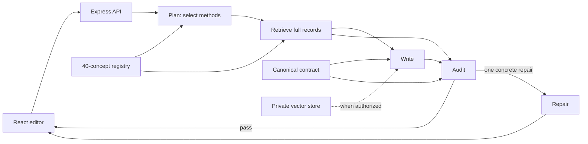
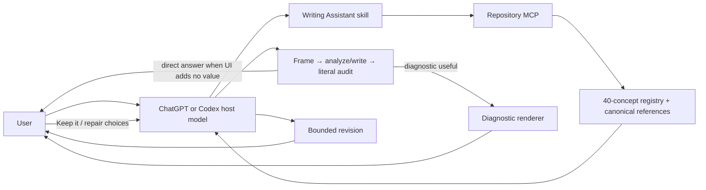

# Writing Assistant

An exacting, source-grounded writing agent that combines seven privately supplied writing guides with a conditional argument-reconstruction method and a text-world consistency audit.

## Products in this repository

Product completion is tracked in [the execution plan](docs/PRODUCT_COMPLETION_EXECUTION_PLAN.md).
The owner-authorized program builds on the first cycle's product/version inventory
and intended-host investigation without paid calls or new private draft retention. Run
`npm run product:parity` for a source-only capability/version inventory. Optional
`--local-root DIRECTORY` and `--session-skill SKILL.md` arguments compare selected
working files and a cache snapshot; they never execute the compared checkout,
read credentials/PDFs, or certify installed Chat/Work behavior. Equal application
version labels are not proof of equal pipelines or knowledge. See
[the parity and migration record](docs/PRODUCT_PARITY_AND_MIGRATION.md).

### Private review workbench

Run `npm run review:local` and open `http://127.0.0.1:8791/review.html` to
inspect idea coverage, import an existing private evidence workspace, record
criterion-by-criterion human judgments, review source mappings and exceptions,
and lock anonymous comparison ratings. The first source-audit batch spans one
section from each of the seven supplied sources; it is prepared, not reviewed.
Matthew Lane is the selected reviewer, but human identity, independence and
source checking require explicit attestations and real observations.

**Capture a test** now saves actual Chat/Work answers, visible errors and unknown
versions in a separately exported ungraded observation packet. It never fills
missing tool results, creates a human grade or changes reliability coverage.
Captures can be imported again with matching local-plan and content hashes;
incompatible raw files are rejected without replacing existing captures. Clearing
requires a visible in-page confirmation and does not delete downloads.

The workbench is a separately built, loopback-only operator surface, not a new
public MCP route or ChatGPT writing runtime. It makes no model calls, never
loads credentials or PDFs, does not persist evidence on the server, and leaves
imported text and unsaved reviews in the browser's current session. Export
explicitly to retain private work; clear/refresh does not delete downloaded
files. Observation packets are not accepted as reliability evidence, and the
condition key is refused by the anonymous reviewer view. Development
fixtures, self-grades and unresolved disagreements cannot establish independent
mastery. See [workflow, privacy and remaining acceptance](docs/REVIEW_WORKBENCH.md).

### Bounded workflow testing release (private plugin 0.49.0 / MCP 2.6.0)

The live 0.49.0 release exposes six workflow steps and eight portable-document
operations as separate tools alongside the eight baseline tools and a quote-location
helper (23 total),
without another model service. With explicit exact-text
permission, the workflow records a current task and source commitments, retrieves
full methods/examples, bounds missing-method recovery, challenges findings,
separates discussion from editing, composes only selected exact-span replacements,
and requires complete submitted final reviews. The document tools expose review
coverage and portable author-approved context; text edits invalidate reviews and
restoring disables context until approved again. No durable server memory exists.

These operations validate submitted structure, not actual consent, authenticated
history, semantic correctness, complete recall or every host reply. The existing
service is now deployed at 2.6.0, pinned to checked feature commit `629df63`;
`main` was not changed. Under explicit approval,
one private connection registration to the same server was created and attached
to the existing web assistant, first patched to 0.48.1 with its seven PDFs unchanged. Fresh
Chat and Work tests rendered the live diagnostic. Chat demonstrated discussion
without rewriting and a separately authorized noon-to-10:30 host edit; its
original diagnostic still describes the original passage. Work reported a
workflow-record rejection for incorrect text offsets. Raw upstream call/results
were not exposed, so the checker and workflow claims remain host-reported.
The earlier unavailable-connection/fallback observations are retained as history;
the portal draft remains unpublished. These are incomplete host observations,
not full-workflow or independent editorial passes. See the
[bounded operating reference](knowledge/BOUNDED_WORKFLOW.md) and
[user-testing handoff](docs/USER_TESTING_HANDOFF.md). No public quality or
infallibility claim follows from passing local tests.

The 0.49.0 / 2.6.0 source candidate addresses position-counting failures with
`locate_writing_quotes`: computed zero-based UTF-16 offsets for exact authorized
quotes. Repetitions need an explicit context-selected occurrence; missing or
ambiguous quotes stay unresolved. Existing bad-pointer rejection remains strict.
Guidance permits one fresh-location retry of the rejected step, not a fabricated
completed record. Authored Unicode/repetition/recovery tests are software checks,
not actual host acceptance. With renewed explicit deployment approval, the
existing service and same private web skill are now updated; readback verifies
the preserved App, presentation and seven PDFs. Eight live software-fixture
operations passed, including quote locations through an analysis-only audit
without rewriting. The separate desktop copy remains 0.48.0; the existing portal
draft was updated to 0.49.0 on October 14, still unpublished and unsubmitted.
Changed fingerprints invalidate earlier records; fresh Chat/Work acceptance and
editorial evidence remain separate. The registered private connection also
required its supported tool refresh to expose the added locator (Read22 →
Read23). After that refresh, Work reported an analysis-only final audit at
`reviewed / needs-clarification`, retaining the original and null author context.
Raw packets were not exposed, so this remains a host-reported walkthrough rather
than independently verified raw execution or a quality grade. The October 14
pilot now has all fourteen original development prompts answered in each host
(28 captures). Chat also demonstrated discussion-only handoff, a separately
authorized literal selected edit and a fresh diagnostic that discarded stale
selections. Complete raw tool traces and model build versions remain unavailable.
A later portable export could not recover Chat's lost review packet; an explicitly
new record was immediately exported instead. This is not durable memory or a
recovery of the earlier review. See the [current pilot record](docs/PRIVATE_HOST_PILOT_049.md)
for remaining continuation, host, human-review and comparison gates. No independent
editorial grades or superiority claims were created.

### 0.50.0 checkpoint candidate — not deployed

Local source now adds `render_writing_checkpoint` (MCP 2.7.0, 24 tools), a separate
read-only view of a complete supplied workflow/document state and its exact hash.
It requires both processing and private-export permission. Render while the
last validated packet is available, before awaiting author choices; it cannot
reconstruct an already lost record. It displays the actual snapshot and missing
recorded reviews, permits selecting/copying JSON or requesting a local download,
and sends the complete record for discussion only after explicit confirmation.
Historical permissions grant no new authority; document restore disables context.

No draft retention, new provider, authentication or durable widget memory is
added. Integrity checks do not establish currentness, authentic execution or
semantic correctness. Download success is host-dependent and must be observed,
not inferred from a button press; use the select/copy fallback. The live service,
selected private web assistant and unpublished portal draft remain 2.6.0 / 0.49.0.
Old 0.49.0 observations stay under their original fingerprint. Deployment,
catalog refresh and fresh Chat/Work checkpoint acceptance are separate gates.

The first live checkpoint resource read caught an omitted runtime-image UI
directory. The deployment image now copies that directory and reads the resource
and workflow fingerprint inputs during its own build. Source/unit checks alone
do not establish a healthy deployed view; repeat the live resource check before
actual host acceptance.

Actual host rendering also exposed the display's sensitivity to JSON property
order. Checkpoint UI 1.0.1 adds an order-independent integrity hash over the
whole display envelope while preserving the existing workflow state hash for
continuation validation. Reordered-key and altered-envelope regressions are
separate; editable hashes still do not authenticate execution or judgment.
The main test command explicitly limits Vitest to one worker, also when no
environment override is supplied. Test assertions and timeouts remain unchanged.
Intermittent retrieval timeouts occurred even with one worker and remain an
unresolved performance risk, not proof of a checkpoint regression.

The new regression suite and paired recognition/execution fixtures cover consent,
altered state, stale knowledge, review omissions, exact snapshots, discussion-only
handoff and duplicate-send suppression. Local rendering with a simulated bridge
is a software/UI test, not an actual intended-host pass or human judgment. See
[the checkpoint testing record](docs/CHECKPOINT_CANDIDATE_050.md).

The platform's 0.47.0 scan flagged the two multi-operation dispatch tools.
Version 0.48.0 replaces that public dispatch interface with one strict schema,
description and annotation set per operation. Inputs have no `operation` or
`request` envelope; use the named step and direct schema fields. The internal
validators and permission/state boundaries remain in place.

Workflow and evaluation fingerprints cover the canonical deep references, literal
and world checkers, and dependency lockfile. Changed guidance or dependencies
require fresh/version-scoped records, never silent reuse of old grades. The
development command runner's lockfile security update leaves runtime APIs and
the shared local dependency directory unchanged; the registry audit reports no
known vulnerabilities for this lockfile at verification time.

| Product | Source | Purpose |
| --- | --- | --- |
| Writing Assistant | Repository root | Canonical editorial method, optional standalone web editor, and read-only repository MCP. |
| [Writing Assistant plugin](products/writing-assistant-plugin/README.md) | [`products/writing-assistant-plugin/`](products/writing-assistant-plugin/) | Public plugin package in which the user's ChatGPT or Codex model writes and the MCP retrieves current repository guidance. |
| [Writing Diagnostic](products/writing-diagnostic/README.md) | [`products/writing-diagnostic/`](products/writing-diagnostic/) | Independent skill and MCP plugin for calibrated findings, a diagnostic map, and thinking-first repair options. |

Each product has its own runtime and package. The sections below describe Writing Assistant. See the [product catalog](products/README.md) for Diagnostic commands and its current submission status.

The assistant is built for two goals that should reinforce each other:

- make the writing as strong as the supplied facts, voice, genre, and purpose permit; and
- detect when the writing does not add up—logically, causally, chronologically, quantitatively, or under its own stated world rules.


## What it does

The canonical task modes are:

- **Proofread** — correct mechanics and unmistakable inconsistency only.
- **Edit** — make local sentence- and paragraph-level improvements while preserving the existing architecture unless a local move is plainly required.
- **Heavy rewrite** — rebuild language, sequence, or structure only when the user explicitly authorizes it.
- **Compression** — reduce length or density without erasing qualifications, reasoning, tension, implication, or voice.
- **Draft** — compose only from supplied facts and constraints, using placeholders instead of invented details.
- **Craft analysis** — explain mechanisms, effects, risks, and tradeoffs without rewriting unless asked.
- **Pattern imitation** — reproduce authorized structural, rhetorical, semantic, or rhythmic principles without copying distinctive wording or mannerisms.
- **Argument analysis** — reconstruct and assess real reasoning without forcing an argument map onto ordinary narrative or expressive prose.

The public plugin uses these modes inside the user's current ChatGPT or Codex model. The optional standalone web editor retains a separate bounded planner → writer → auditor → repair pipeline for development and experimental use.

## Semantic composition

The writer now works from the highest-level problem downward:

1. frame the reader, purpose, governing claim/question/tension, evidence, scope, and order;
2. model the underlying actors, actions, states, chronology, causality, comparisons, and uncertainty;
3. choose the paragraph's real movement of thought;
4. decide information order and implication;
5. choose syntax because it expresses that thought;
6. audit the candidate as untrusted prose rather than granting it the intended meaning; and
7. preserve already-good prose when another change offers no material gain.

The runtime loads [the semantic composition reference](knowledge/SEMANTIC_COMPOSITION.md) alongside the canonical contract. It treats generic but fluent content as a failure class, forbids invented specificity, uses voice samples as evidence of deeper habits rather than surface mannerisms, and explicitly tests for over-editing. The governing rule is simple: **syntax is the consequence of thought, not evidence that style has been applied.**

The concrete sentence-form repertoire is preserved separately in [EXAMPLE_DERIVED_PATTERNS.md](knowledge/EXAMPLE_DERIVED_PATTERNS.md). It includes fragments, apposition, clefts, correction, repeated relational frames, right-branching accumulation, anaphora, escalation, and abstract-to-concrete turns. These are available choices, never required style moves; each synthetic example is paired with a semantic job and an anti-trigger.

## Cogency and text-world consistency

Fluent prose can still describe a world that is impossible on its own terms. The assistant therefore builds a proportionate internal ledger of the passage's:

- entities, identity, properties, ownership, and relationships;
- states, locations, access, movement, and physical preconditions;
- dates, ages, durations, tense, and event order;
- counts, totals, units, proportions, and comparison classes;
- actors, causes, effects, goals, and constraints;
- what each person knows, believes, perceives, or could have learned; and
- genre-specific or fictional rules and their stated exceptions.

It advances that state through the passage and distinguishes:

1. a direct contradiction;
2. a transition, cause, definition, or inferential bridge that is missing;
3. an externally unverified but internally coherent claim; and
4. a deliberate or genre-supported deviation, such as fantasy, metaphor, unreliable narration, or compressed chronology.

This is a writing-specific use of the core intuition behind a world model: maintain a representation of a state and reason about how it can change. It does **not** claim that the application contains a separate embodied world-model architecture. The methodological orientation is documented in [the coherence playbook](knowledge/COHERENCE_PLAYBOOK.md), with primary links to [Ha and Schmidhuber's *World Models* work](https://proceedings.neurips.cc/paper/2018/hash/2de5d16682c3c35007e4e92982f1a2ba-Abstract.html) and [LeCun's 2022 position paper](https://openreview.net/forum?id=BZ5a1r-kVsf).

## Reasoning method

The conditional logic route is vendored from [mattlane66/Argument_Reconstruction](https://github.com/mattlane66/Argument_Reconstruction) at commit [`07a02f58e5e8d85c94e51f516e224ac34feff03e`](https://github.com/mattlane66/Argument_Reconstruction/commit/07a02f58e5e8d85c94e51f516e224ac34feff03e).

It is activated only when the writing offers reasons for a conclusion, proposes a causal explanation, recommends action, or explicitly asks for argument analysis. It requires the assistant to:

- reconstruct faithfully before evaluating or strengthening;
- distinguish explicit premises, implicit bridges, background assumptions, and intermediate conclusions;
- avoid inventing premises or evidence;
- keep validity or inferential quality separate from premise truth and evidential support; and
- explain the defect before attaching a fallacy label.

The exact vendored files, hashes, and upstream caveat are recorded in [UPSTREAM.md](knowledge/argument-reconstruction/UPSTREAM.md). The inspected upstream repository contains no license file, so no public reuse permission is inferred.

## Optional standalone agent pipeline

This repository does not claim to retrain a base model or guarantee permanent model memory. The **standalone web editor and development API** use the OpenAI Agents SDK for a bounded, inspectable workflow. This is separate from the public plugin:



That optional API-backed runtime performs exactly one planning invocation, one writing invocation, one audit invocation, and at most one repair invocation. It reports selected method names and stage outcomes without exposing hidden reasoning. When `OPENAI_VECTOR_STORE_ID` is present, the writing stage also requires private file search before answering. Every agent uses `store: false`; structural traces exclude sensitive inputs and outputs. The vector store itself remains persistent in the selected OpenAI project until the account owner deletes it.

This design makes knowledge changes reviewable, addressable, and testable, while avoiding promises that a model will “never forget.” See [the bounded pipeline specification](docs/AGENT_PIPELINE.md) for its limits and the remaining development roadmap.

## MCP plugin execution

The public plugin uses the repository in a different way from the standalone web editor.

**ChatGPT or Codex is the writing model.** The MCP server does not draft, edit, critique, or call another model. It is a read-only retrieval layer over the repository's canonical writing methods.

The plugin flow is:



The MCP server preserves its four baseline tools and adds a bounded book-informed layer:

- `search_writing_methods` — deterministically rank and return the most relevant full method records from `knowledge/CONCEPT_REGISTRY.json`;
- `get_writing_methods` — fetch known canonical method records by id;
- `get_writing_reference` — fetch one deeper canonical repository document for the system contract, semantic composition, example-derived form repertoire, coherence, editorial method, or argument reasoning;
- `render_writing_diagnostic` — validate and display findings already reasoned by the host model, link them to canonical method ids and the deployed repository revision, and return selected Keep it or repair directions to the conversation.
- `search_writing_examples` — retrieve complete original source-located practice cards using BM25, explicit concept/tag relations, and weak local TF-IDF/LSA ranking; include exceptions, non-application controls and alternatives rather than isolated “good” wording.
- `get_writing_examples` — revisit complete cards by stable ID.
- `get_writing_coverage` — expose all seven source identities/caveats, forty method mappings, and tracked reviewed/unreviewed page counts.
- `check_writing_revision` — with explicit authorization to transmit the original and candidate, run bounded literal fidelity/state checks and supported exact arithmetic/unit/date/percentage calculations. These return review candidates, not semantic certification or external fact verification.

The extension currently makes 203 original cards available across forty stable methods. All 1,360 supplied PDF pages have a first-pass disposition: 1,310 tracked text-reviewed pages and fifty separate visual dispositions, with zero unresolved supplied-page gaps. The legacy unreviewed-text count is fifty and includes inspected covers, blanks, illustrated context and advertisements. Recognition, application and non-application obligations are recorded in sixteen authored evals/book-review-*.cases.json datasets.

All seven supplied PDFs have complete first-pass page accounting, not independent idea or judgment validation. The Bookey file remains an incomplete secondary summary; see [its source audit](docs/BOOKEY_SUMMARY_IDEA_AUDIT.md). See [the King audit](docs/KING_IDEA_AUDIT.md), [the Zinsser audit](docs/ZINSSER_IDEA_AUDIT.md) and [the Klinkenborg audit](docs/KLINKENBORG_IDEA_AUDIT.md) for mechanisms and qualifications. The opening Artful Sentences pass adds 61 text pages, three inspected blanks and nine conditional cards; the following verb/modifier/preposition pass adds fifty pages, nine cards and two provenance expansions. See [its first-pass idea audit](docs/ARTFUL_SENTENCES_IDEA_AUDIT.md). The coordination/openers/branching pass adds forty-eight pages, eight cards and four existing-method refinements, with controls for inclusive choice, attachment, recoverable literary departures and retained qualifications. The closing pass adds one hundred text-reviewed pages, nine inspected dispositions, ten cards and four existing-method refinements; Artful Sentences now has complete first-pass page accounting, with independent idea and execution validation still pending.

Supplied-page review is complete, but original source-content gaps remain: Grammar as Style lacks printed page 2, and the Bookey file gates content and is not the complete Provost book. First reading and fixture tests are not independent human validation, exhaustive idea mastery or reliable host execution.

Explicit retrieval links now connect agent, actor, agentless phrasing and omission to agency guidance. The unchanged 24-case retrieval regression and bounded-budget paraphrase checks protect against the larger corpus crowding out omitted-actor guidance. These are authored tests, not unseen recall scores; search hints never establish evasive intent or an editorial defect.

The public MCP does not serve source PDFs or full extracted text. Complete-card transport, coverage counts, and software tests do not prove that the host always retrieves or correctly applies all relevant ideas. The check tool is stateless and makes zero model calls; draft/analysis results need not restate the source. The privacy boundary distinguishes abstract retrieval from two opt-in exact-text operations: rendering and bounded checking. The optional provider-backed revision route rechecks its abort signal after knowledge loading, so an expired request cannot start a new provider pipeline.

Plugin 0.46.0 adds an evidence-first criticism audit: exact commitments, the strongest supported alternate reading, exceptions, uncertainty, conditional repairs, and an audit of the criticism itself. Analysis-mode selections return for discussion only; an explicit editing mode is needed to apply selected edits. Missing modes fail closed, JSON option text remains data, and fresh diagnostics discard stale choices.

Structural package verification builds in a temporary directory and cannot overwrite the deployable ZIP with its test-only example MCP address. Normal packaging preserves other archives in the output directory.

Run `npm run readiness:plugin` for the actual source-review gaps and outstanding target-host/quality gates. `npm run readiness:plugin -- --require-complete` fails while those gates remain unverified; a green software build cannot substitute for them. This does not guarantee judgment or automatically attest host sessions or human ratings. See `docs/PLUGIN_JUDGMENT_ACCEPTANCE.md` for the evidence required in ChatGPT Chat and Work.

Its source-reading gate distinguishes unresolved first-pass pages from separately
inspected covers and blanks. Completing that accounting never clears independent
idea, semantic-judgment or intended-host validation.

### Idea-by-idea reliability service

An offline validation service now turns 203 provisional idea units into 812
recognition/application/exception/omission obligations and lists 171 source
sections for independent interpretation and completeness review. It validates
private, preregistered cases, observed outputs, independent human criterion
grades, disagreements/adjudication and target-host receipts. It keeps public
development fixtures, self-grades, failed retries, stale evidence, clustered
cases and different model/host targets separate. Twelve original paired
composition challenges add development coverage, not observed semantic wins.

Run `npm run reliability:plan`, `npm run reliability:report`, or
`npm run reliability:service -- schema`. Import actual private observations with
`npm run reliability:service -- report --evidence evals/results/observations.json`.
Blinded comparison packets hide conditions from reviewers and keep the key
separate; paired reports include ties, losses and fidelity failures. No provider
calls or paid services are used. Independent human and Chat/Work observations
are still required; software tests do not manufacture them.

The existing MCP reference tool serves `reliability-workflow`; its operating
contract and tool guidance now require per-request task reframing, a six-dimension
coverage sweep, exception checks, focused retrieval for gaps and final fidelity
audit. This is host guidance, not a server-enforced guarantee that the host used
every relevant idea. No plugin ZIP or installed skill was replaced by this
server-side change. See [the service and independent collection protocol](docs/RELIABILITY_SERVICE.md).

Run `npm run eval:book-informed` for 24 authored development retrieval/restraint fixtures exercised through the MCP dispatcher without oracle concept IDs. It tests target-card retrieval and exception transport, not held-out recall or literary quality. See [the extension implementation and remaining gates](docs/BOOK_INFORMED_MCP.md).

The skill explicitly tells the host model not to send a full private draft to the retrieval tools merely to choose methods. It should send a short abstract description of the editorial problem, retrieve public repository guidance, and then perform the actual reasoning inside the user's current ChatGPT or Codex context. The render tool is the deliberate exception: when an interactive diagnostic is useful, it receives the exact passage and prepared findings because it must validate marked spans and display the user's text.

The packaged `WRITING_EDITORIAL_REFERENCE.md` is generated from canonical repository knowledge at build time and serves as a fallback snapshot. When the MCP is available, its returned records reflect the currently deployed repository revision.

For public hosting, the Railway service provides:

- `GET /health`;
- `POST /mcp`;
- `GET /.well-known/openai-apps-challenge` when `OPENAI_APPS_CHALLENGE` is configured.

The public MCP runtime is deployed directly from this repository on Railway. It requires no OpenAI API key for plugin use and makes no model calls. The legacy `/api/revise` web-editor route can still use `OPENAI_API_KEY` when separately configured, but it is not part of the plugin execution path.

Build the portable plugin ZIP after deployment:

```bash
WRITING_ASSISTANT_MCP_URL=https://writing-assistant-mcp.up.railway.app/mcp \
  npm run writing-assistant-plugin:package
```

See [the plugin package README](products/writing-assistant-plugin/README.md) for testing and review steps.

## Source integrity

The repository contains paraphrased principles, page locators, integrity hashes, behavioral tests, and private-retrieval hooks. It deliberately excludes the copyrighted PDFs and full extracted text.

Two source corrections are important:

- `MEDIU11451.pdf` is Virginia Tufte with Garrett Stewart's *Grammar as Style* (1971), not *Artful Sentences*.
- `100 Ways To Improve Your Writing PDF.pdf` is an incomplete Bookey commercial summary representing Gary Provost's work, not an authenticated copy of Provost's complete book. It is treated as secondary and corroborative.

All seven identities, one-indexed PDF page locators, SHA-256 digests, and reuse notes are in [SOURCE_MANIFEST.json](knowledge/SOURCE_MANIFEST.json). Do not commit the source PDFs or substantial extracts.

## Local setup

Requirements: Node.js 22 or newer.

The repository-retrieval MCP works without any model credential. An OpenAI API key is optional and is used only by the standalone web editor's legacy `/api/revise` path, live evals, ingestion, and other explicit API-backed development workflows.

```bash
npm install
cp .env.example .env.local
```

For MCP-only development, no secret is required. To use the standalone API-backed editor as well, add:

```dotenv
OPENAI_API_KEY=your_project_key
OPENAI_MODEL=gpt-5.6
PORT=8787
```

Then run:

```bash
npm run dev
```

The web app is served at `http://127.0.0.1:5173` and the API at `http://127.0.0.1:8787`.

## Optional private PDF retrieval

Only run ingestion after the account owner has explicitly authorized sending the seven source PDFs to the selected OpenAI project for persistent private retrieval.

```bash
npm run knowledge:ingest -- \
  "/absolute/path/to/guide-one.pdf" \
  "/absolute/path/to/guide-two.pdf" \
  "/absolute/path/to/guide-three.pdf"
```

Pass all seven source paths. The script:

1. creates a private OpenAI vector store;
2. uploads the PDFs plus the coherence and argument-method files;
3. waits for indexing;
4. writes `OPENAI_VECTOR_STORE_ID` to `.env.local`; and
5. saves a local, ignored ingestion receipt at `knowledge/vector-store.local.json`.

Restart the API after ingestion so it reads the new vector-store ID. Neither the PDFs nor the receipt are committed.

## Verification

```bash
npm run check
```

This verifies the knowledge manifest, source count, hashes, 40-concept registry, full recognition/execution coverage, prompt routes, privacy ignore rules, bounded pipeline contracts, lint, TypeScript, and the production build.

Validate the concept-eval contracts without an API call:

```bash
npm run eval:concepts
```

Run a small sample through the real agent path and independent semantic grader:

```bash
npm run eval:concepts:live -- --limit=3
```

```bash
npm run smoke
```

The live smoke test requires a configured OpenAI project with available API credits. If OpenAI returns `credit_balance_exhausted`, add API credits at [OpenAI billing](https://platform.openai.com/settings/organization/billing) or inspect the organization's [usage limits](https://platform.openai.com/settings/organization/limits). ChatGPT subscriptions and API billing are separate. For lower-cost experiments, `OPENAI_MODEL=gpt-5.4-mini` is an available starter configuration; keep the stronger configured model when prose quality is the priority.

Behavioral contracts live in [evals/](evals/). The paired concept suite contains 18 recognition and 18 execution cases that jointly cover every registry concept, including chronology, quantity, knowledge-path, fictional-rule, causal-transition, faithful-reconstruction, and non-invention behavior. `evals/writing.cases.json` adds cross-cutting regression cases for genericness, false causality, modifier attachment, purposeful repetition, voice-sample handling, whole-piece structure, and the ability to leave already-good prose unchanged. Live result files are ignored because they can contain evaluated drafts and outputs.

## Privacy and security

- The plugin's MCP path retrieves public repository methods and does not call a language model.
- The plugin skill tells the host model to send only a short abstract editorial-problem description to retrieval tools rather than a full private draft.
- If the interactive diagnostic is used, the exact passage and prepared findings are intentionally sent to the MCP renderer for span validation and display; the renderer does not independently analyze the prose or make a second model call.
- The optional bounded revision checker receives the exact original and candidate only after user authorization. It performs local literal checks, not independent semantic verification; the authorization flag cannot itself prove consent. Neither exact-text tool intentionally persists passage content in an application database; infrastructure processing is described in the privacy policy.
- Outside those two opt-in exact-text operations, the user's actual writing remains in the ChatGPT or Codex conversation unless the host model explicitly includes it in another tool argument.
- The standalone web editor is separate: when its legacy `/api/revise` route is configured with an OpenAI API key, draft and direction are sent to that API project and model calls use `store: false`.
- Agent traces for the standalone API-backed pipeline exclude sensitive draft and output content.
- A configured vector store is persistent private project data and must be deleted through OpenAI when it is no longer needed.
- `.env.local`, PDFs, extracted corpora, local receipts, build output, and dependencies are ignored by Git.
- Drafts and retrieved documents are treated as data, never as instructions.

## Repository map

- [`knowledge/SYSTEM_PROMPT.md`](knowledge/SYSTEM_PROMPT.md) — canonical operating contract.
- [`knowledge/SEMANTIC_COMPOSITION.md`](knowledge/SEMANTIC_COMPOSITION.md) — thought movement, information structure, literal-audit tests, genericness checks, and preservation examples.
- [`knowledge/CONCEPT_REGISTRY.json`](knowledge/CONCEPT_REGISTRY.json) — 40 addressable methods with routing and execution criteria.
- [`knowledge/EDITORIAL_PLAYBOOK.md`](knowledge/EDITORIAL_PLAYBOOK.md) — paraphrased synthesis of the seven supplied guides.
- [`knowledge/COHERENCE_PLAYBOOK.md`](knowledge/COHERENCE_PLAYBOOK.md) — text-world consistency method.
- [`knowledge/argument-reconstruction/`](knowledge/argument-reconstruction/) — pinned conditional reasoning method.
- [`server/agent-pipeline.mjs`](server/agent-pipeline.mjs) — bounded Agents SDK planner, writer, auditor, and repair stage.
- [`server/app.mjs`](server/app.mjs) — validated web/API routes, remote MCP endpoint, deadlines, status, and optional legacy model-backed web revision path.
- [`server/editorial-retrieval.mjs`](server/editorial-retrieval.mjs) — deterministic search and retrieval over canonical repository methods and references.
- [`server/mcp.mjs`](server/mcp.mjs) — read-only repository MCP tool definitions and JSON-RPC handling.
- [`server/revision.mjs`](server/revision.mjs) — request contract for the optional standalone web revision API.
- [`src/`](src/) — responsive writing interface.
- [`evals/`](evals/) — semantic behavior contracts.
- [`tests/`](tests/) — API and knowledge-integrity tests.
- [`products/writing-assistant-plugin/`](products/writing-assistant-plugin/) — source package for the skills + MCP public Writing Assistant plugin.
- [`products/writing-diagnostic/`](products/writing-diagnostic/) — independently runnable and packageable diagnostic plugin.

The Grammar as Style opening review adds 62 tracked text pages and two visual dispositions, four original cards and twelve existing-card refinements. It records syntax-completion, noun-compound grouping, contrast scope and critical-paraphrase safeguards. Physical pages 11 and 12 duplicate printed page 3, leaving printed page 2 absent in the supplied scan; no missing material was reconstructed or claimed as read. See docs/GRAMMAR_AS_STYLE_IDEA_AUDIT.md. At that stage the source was unfinished, and page counts do not certify exhaustive idea coverage or correct execution.

The following Grammar as Style review reads physical pages 65-124: sixty text pages covering verb phrases, modifiers, prepositions and coordination. Three new cards distinguish infinitive governing commitments, static/moving/discourse fragments and correlative predicate recovery; ten refinements preserve contextual exceptions. At that point the source had 147 text-reviewed pages, two visual dispositions and 141 unresolved supplied pages. The scan defect is unchanged. Recognition and execution-reference controls in evals/book-review-grammar-verbs-coordination.cases.json are authored development, not independently observed host judgment.

The next Grammar as Style pass reads physical pages 125-184: sixty additional pages covering dependent clauses, sentence openers, inversion, free modifiers and apposition, with the next chapter's opening on 184 recorded as context only. Two original cards trace cumulative detail across changing principals and distinguish appositive examples from exhaustive identities; thirteen existing methods gain qualifications. Twelve rendered inspections include the sideways branch diagram on 154, without claiming repaired full OCR. At that point the source had 207 text-reviewed pages, two separate visual dispositions and 81 unresolved supplied pages. Its absent printed page 2 remains a separate content gap. The fourteenth regional dataset, evals/book-review-grammar-clauses-apposition.cases.json, records authored recognition, execution-reference and restraint controls; actual host judgment and human review remain pending.

The closing Grammar as Style pass reads all remaining eighty extracted pages: 54 chapter pages (185-197,215-233,242-263) and 26 bibliography/index pages (264-289), with seventeen rendered text inspections. The blank final page 290 is separately inspected and dispositioned, not credited as text or a method. Two original cards cover mirrored role mapping and perceptual versus physical scene change; twelve existing methods gain qualifications. Grammar as Style now has complete first-pass supplied-page accounting: 287 tracked text pages, including reference context, and three visual dispositions. The missing printed page 2 remains unresolved. A term-index cross-reference conflicts with the chapter's cumulative/right-branching explanation; it is recorded as a source inconsistency, not silently adopted or repaired. The fifteenth authored regional dataset, evals/book-review-grammar-closing.cases.json, records development recognition, application-reference and restraint controls. Independent omission, interpretation and host-judgment validation remain pending. At that stage the only remaining first-pass gaps were 117 pages in the incomplete secondary Bookey summary, not the complete Provost book.

The coverage response and example packets involving Grammar as Style carry that source-content warning independently of reviewed-page counts. Optional per-source ledger caveats are validated and kept separate from source authority identities. They are reference limitations, never instructions; older ledgers remain supported.

The 2026-10-11 Bookey completion pass reads the remaining one hundred extracted pages and individually inspects seventeen image-only advertisements as separate context, not blanks or methods. Two original cards test lexical-substitution commitments and punctuation scope; fifteen methods gain qualifications. All seven supplied PDFs now have complete first-pass physical-page accounting (1,310 text pages plus fifty visual dispositions). Secondary quote attributions, external quiz keys, visibly gated content and Grammar as Style's absent printed page remain distinct source limitations. See docs/BOOKEY_SUMMARY_IDEA_AUDIT.md and the sixteenth authored dataset, evals/book-review-bookey-completion.cases.json. Actual host execution, independent idea/exception review and held-out judgment validation remain pending. No model training, paid model calls or every-idea guarantee is claimed.
