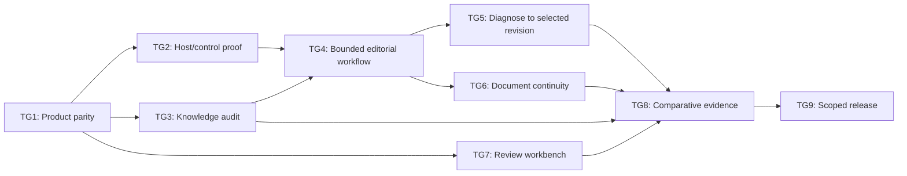

# Writing Assistant — product completion execution proposal

Prepared 2026-10-11 for Matthew Lane. The owner approved the first-cycle scope and starting with product/version parity in this conversation: "yes. this all sounds right ... Let's carry that out." The broader program remains the working roadmap; downstream architecture, private-data, provider and publication gates remain explicit. This is not a completed release or a promise of infallibility.

Update 2026-10-12: the owner subsequently directed execution of the entire plan and its most important next work. This authorizes dependency-ready implementation, not paid calls, remote private retention, public deployment, assumed host capabilities, or fabricated human acceptance. Matthew Lane is the designated independent editorial reviewer. His designation does not itself constitute a grade or a case-specific independence attestation.

## 1. Readiness check

The user's requested destination is a book-informed assistant that drafts, diagnoses, edits, compresses, reasons about arguments and scenes, preserves good writing, and provides an effective interactive experience in ChatGPT Chat and Work. The 2026-10-11 stocktake supplies current-system evidence.

| Dimension | Status | Evidence / decision needed | Before build? |
|---|---|---|---|
| Problem and outcome | Clear | Good prose can still change meaning; retrieval and instructions do not establish correct application. | No further framing required for a feasibility investigation. |
| Existing product | Clear, split | Live repository MCP and installed skill; richer local prototype has different capabilities and older knowledge. | Inventory differences before porting. |
| Approach | Proposed | Host-model writing plus deterministic workflow validation and interactive choices; alternative is a provider-controlled runtime. | Resolve host-control feasibility before commitment. |
| Appetite | Program execution authorized | Fixed-scope feasibility cycle below; later cycles retain concrete boundary/budget gates. | No new calendar or provider budget inferred. |
| Behavior | Partly specified | Mode, source, preservation and privacy contracts exist; session control and project continuation require new contracts. | Accept concrete behavior before activating a build group. |
| Quality evidence | Missing | Independent source interpretation, unseen judgments, blind comparisons and intended-host usability remain unverified. | Evidence collection can begin early; release claims cannot. |
| External decisions | Partly open | Matthew Lane designated as reviewer; actual grades, additional adjudicators, competitor access, missing primary-source editions, host activation and any durable storage remain outstanding. | Resolve when the relevant group reaches its gate. |

Planning method: the local Implementation Planner provides the execution structure. The selected Planning Skills repository supplies the distinction between working evidence and accepted intent. The owner approved the first fixed-scope cycle and TG1 activation. That does not promote the still-unresolved A/B architecture or the existing separate intent pilot to accepted truth.

## 2. Project boundary

- Primary product: the existing Writing Assistant plugin used in ChatGPT Chat and Work. Preserve its identity and existing MCP endpoint.
- Secondary surface: the optional local editor, used for development, comparisons and approved local workflows. Do not turn it into a competing source of editorial truth.
- Operator surface: an accessible quality-review workbench over the existing reliability service.
- Desired outcome: useful, traceable, restrained editorial work with measured quality and explicit gaps, not merely more retrieved text.
- Preserve: stable concept IDs; source identities/caveats; original example provenance; narrow mode authorization; unchanged-original decisions; exact-text processing consent; no committed credentials, PDFs, extracted text or private evaluation receipts.
- Financial boundary: no new paid services, purchases, API billing, automatic provider fallback or provider calls during planning. Existing hosting costs are not assumed to be zero. Live free-tier/API pilots need an explicit call budget, consent and verified service eligibility.
- Non-goals: foundation-model training, a physical world simulator, universal fact checking, copying authors' distinctive wording, automatic publishing, automatic promotion of feedback into rules, or correct judgment on every future request.
- Release boundary: a controlled pilot precedes any public quality claim. Full program completion includes independent validation, not just implementation.

### Accepted first-cycle appetite

Use a fixed-scope feasibility cycle rather than a fabricated calendar estimate: one release/capability manifest, one reproducible intended-host walkthrough, one workflow-control feasibility experiment, and one first-slice proposal backed by that evidence. No new hosting, authentication system, server retention of drafts, provider calls, or public release in this cycle. Stop if the selected host or necessary access is unavailable; document the exact missing observation without substituting Codex or a simulated bridge.

The owner has authorized the full program's implementation. Later cycles still need concrete scopes and separate approval for any new paid or remote-data boundary after learning from this cycle. The full program is not a promise to fit an unspecified time budget.

## 3. Kickoff and current baseline

The central engineering problem is to connect the method bank, host reasoning, evidence-backed criticism, user choices and final revision into one coherent workflow. The central empirical problem is to find out whether that workflow helps without increasing false criticism or meaning loss.

Historical first-cycle baseline (retain for comparison, not current deployment):

- Live source revision: `76acb7e26ba71f615e2f17625aca6d1b3987fb1a`; corpus `2.20.0`.
- Forty methods; 203 original cards; 1,360 supplied PDF pages dispositioned as 1,310 text-reviewed and fifty separately inspected visual/context pages; zero unresolved physical-page dispositions.
- Eight public MCP tools; the host model performs writing and judgment; the server makes no model calls.
- The readiness service defines 203 provisional idea units, 812 recognition/application/exception/omission obligations and 171 independent source-section reviews. No independent human judgments or blind comparisons are established in the checked readiness record.
- The richer local working files contain semantic planning, missed-method recovery, final verification, short candidate comparison, project context, preferences, feedback and local PDF search. They are not all in the public plugin snapshot; its older local card/page counts are not the current public coverage figures.
- The prior TG1 check passed 605 software tests; the TG7 private workbench adds 32 regression tests. Software and retrieval tests are not editorial-effectiveness evidence.
- Existing `planning/01-frame.md`, `02-shaping.md`, `03-breadboard.md` and `product-intent.json` remain a separate working deterministic-intent pilot. This proposal neither promotes nor overwrites them. New requirement IDs below do not replace that pilot's R0–R6.

Current execution baseline, October 14: the specifically selected private web
assistant and existing unpublished portal draft are 0.49.0; MCP 2.6.0 exposes 23
individual tools and is pinned to feature commit `629df63`. The separate desktop
copy remains 0.48.0. All 727 software tests passed without weakened assertions.
The fourteen original development prompts now have actual captured answers in
both Chat and Work (28 observations), not independent semantic grades. Raw tool
traces and model build versions remain unavailable; the portable continuation
test exposed loss of the earlier client-carried review packet. See the dated
release manifest and [pilot record](PRIVATE_HOST_PILOT_049.md), not historical
baseline paragraphs, for the current scope and remaining gates.

October 15 update: the same private assistant is 0.50.0 / MCP 2.7.0 with 24 tools
and an explicitly authorized author-owned checkpoint view. Live checks caught and
repaired a missing runtime UI asset. Actual Work tests then exposed a display
hash failure and a rejected diagnosis record. UI 1.0.1 repairs order-sensitive
display integrity while preserving canonical workflow hashes; all 750 software
tests passed. Fresh Chat and Work visibly rendered/selectively handed off the
checkpoint for discussion; both reported exact restoration with context disabled
(Work required separate typed permission). Raw tool traces remain unavailable.
Selected-edit/final-audit, cross-thread continuity and independent editorial
acceptance remain open. See [the checkpoint gate](CHECKPOINT_CANDIDATE_050.md).

### Working requirements

All WA-R requirements are proposed, not human-accepted requirements.

| ID | Requirement | Status | Origin |
|---|---|---|---|
| WA-R0 | Demonstrate useful editorial improvement over named alternatives without hiding fidelity, invention, false-criticism or delivery failures. | Core goal | User's superiority and reliability requests. |
| WA-R1 | Support proofreading, editing, authorized rewriting, compression, drafting, craft diagnosis, pattern-based alternatives and conditional argument analysis. | Must-have | Existing product services. |
| WA-R2 | Protect supplied facts, voice, uncertainty, scope, implication and good existing language; distinguish contradiction, ambiguity, missing information and stylistic preference. | Must-have | User's cogency and preservation goals. |
| WA-R3 | Make relevant source methods, exceptions, alternatives and limitations accessible and reviewable; expose unresolved knowledge gaps. | Must-have | Fully book-informed goal, qualified by actual source defects. |
| WA-R4 | Make procedure and missing checks visible without representing a model declaration or receipt as proof of correct judgment. | Must-have | Runtime execution gap. |
| WA-R5 | Let a user inspect findings, preserve or discuss them, authorize selected changes and understand what changed without accidental rewriting. | Must-have | Chat/Work diagnostic workflow. |
| WA-R6 | Support bounded long-document continuity and author-approved project context without silently turning inference into fact. | Must-have for full program | Long-document/context gap. |
| WA-R7 | Preserve privacy, user control, version consistency, provider boundaries and the no-new-spend constraint. | Must-have | Repository policy and user constraints. |
| WA-R8 | Make independent review, failure analysis, feedback and version-scoped retesting usable by the operator. | Must-have | Reliability workbench and optimization goal. |

## 4. Technical design proposal

### Candidate directions and working fit

CURRENT: a read-only retrieval/checking/rendering plugin with host-guided reasoning; advanced local capabilities are separate.

A: keep writing in the host; consolidate knowledge, add validated request/decision envelopes, deterministic transitions and a guided interactive workflow. Server validation applies only to operations it receives. A host that bypasses the tools cannot be stopped from answering directly by this design.

B: run a controlled writing/audit pipeline in our runtime and expose it through the plugin. This provides stronger stage control but introduces provider access, transmission, quota, latency and possibly cost. It does not prove better semantic judgment and cannot assume access to the user's ChatGPT model through the MCP connection.

These are materially different control mechanisms. A future runtime-specific host integration might provide another option; investigate supported hooks rather than assume they exist in every Chat/Work host.

| Working requirement | CURRENT | A | B |
|---|:---:|:---:|:---:|
| WA-R0 — measured improvement | ❌ | ❌ | ❌ |
| WA-R1 — defined editorial modes | ✅ | ✅ | ✅ |
| WA-R2 — demonstrated fidelity and calibrated judgment | ❌ | ❌ | ❌ |
| WA-R3 — independently audited source interpretation and retrieval | ❌ | ❌ | ❌ |
| WA-R4 — observed procedural coverage in intended hosts | ❌ | ❌ | ❌ |
| WA-R5 — verified diagnosis-to-selected-revision flow | ❌ | ❌ | ❌ |
| WA-R6 — verified bounded document/project continuity | ❌ | ❌ | ❌ |
| WA-R7 — no new paid dependency and reviewed data boundaries | ✅ | ❌ | ❌ |
| WA-R8 — usable, independently populated review workflow | ❌ | ❌ | ❌ |

Unknown is not a pass. CURRENT's WA-R7 pass describes the existing credential-free retrieval path, not independent certification of all privacy behavior. A needs a reviewed exact-text/session boundary; B additionally lacks an approved free runtime. The recommendation is to investigate A first, not to declare it selected or complete.

### Proposed parts and reverse fit

| Part | Mechanism | Requirements served | Important uncertainty |
|---|---|---|---|
| A1 | One versioned registry/card corpus and release/capability manifest across surfaces. | WA-R1, WA-R3, WA-R7 | Local/public schema differences and installation provenance. |
| A2 | Request-scoped evidence and transition envelopes; exact text consent where needed; bounded stages and honest incomplete states. | WA-R2, WA-R4, WA-R7 | What the actual host reliably invokes; stateless validation versus authenticated retention. |
| A3 | Intent framing, semantic commitments, source/exception recovery, criticism challenge and one bounded repair/audit. | WA-R1, WA-R2, WA-R3, WA-R4 | Helpful execution versus checklist compliance and extra latency. |
| A4 | Interactive exact-span findings, competing readings, keep/discuss/apply controls and version-bound change review. | WA-R2, WA-R5 | Host bridge behavior, accessibility, stale choices and large passages. |
| A5 | Bounded document ledger and explicit portable author-approved context. | WA-R2, WA-R6, WA-R7 | Omitted document portions, restoration and safe persistence. |
| A6 | Local operator review UI, independent observations, blinded comparisons, feedback promotion and regression reports. | WA-R0, WA-R3, WA-R8 | Reviewer availability, representative cases and adequate precision. |

Every proposed part serves a stated need. A2/A3 carry disproportionate responsibility and must be tested before investing in polish. Keep data validation separate from rendering. Do not produce or expose hidden chain-of-thought; store only necessary source commitments, decisions and concise evidence.

### Surfaces

| Surface | Existing seam | Proposed change |
|---|---|---|
| Canonical knowledge | `knowledge/`, `server/book-informed.mjs`, local source-card code | Reconcile records without discarding provenance or exceptions; version corpus once. |
| Plugin skill/package | `products/writing-assistant-plugin/`, packaging script | Sync workflow and fallback snapshot; prove activated version rather than infer it from deployment. |
| MCP boundary | `server/mcp.mjs`, `server/app.mjs` | Focused workflow operations if justified; strict schemas, bounds and truthful annotations. |
| Editorial runtime | Local `server/agent-pipeline.mjs` and related contracts | Extract portable concepts; do not wholesale merge model-provider plumbing into public MCP. |
| Diagnostic | `products/writing-diagnostic/` renderer reused by Writing Assistant | Extend the shared renderer once; avoid a divergent fork. |
| Document/context | Local document state and `src/lib/projectMemory.ts` | Reuse reviewed contracts; add portable, explicit continuation before remote accounts. |
| Review/evaluation | `evals/reliability-service.mjs`, blinded comparison, ignored results | Accessible review/import interface; distinguish software, retrieval and observed editorial evidence. |
| Release | Existing CI, Railway service, package workflow | Parity checks, explicit package activation, failure metrics, rollback and acceptance evidence. |

### Data ownership and proposed contracts

- Canonical methods/examples: public repository, stable IDs, reviewed changes only.
- Source PDFs/extracted index: private local reference; no public transport or repository commit.
- Request frame: mode, purpose, reader, genre, scope, invention permission and six checked/inapplicable/unresolved dimensions. No full draft in abstract retrieval.
- Exact-text evidence: original/candidate version, offsets and quoted support, interpretations versus assertions versus unknowns. Process only under an explicit reviewed boundary.
- Findings: problem mechanism, source commitment, strongest supported alternate reading, applicable method and exception, uncertainty, conditional repair; no confidence percentage unless calibrated.
- Decisions: selected finding IDs and original version, explicit requested action, stale-state rejection, unselected material preserved. A discussion payload is not rewrite authorization.
- Revision: exact original/candidate anchors, invariant review, bounded literal signals, semantic questions left open, unchanged/clarify/withheld outcomes when warranted.
- Project context: author-approved facts, terminology, voice samples, decisions and open questions; explicit enablement, correction, export and deletion. No automatic fact promotion.
- Private evaluation: original outputs and oracle data in ignored protected files; blind condition key separate from reviewer packets; no raw-draft analytics.
- Durable remote storage: not authorized by this plan. Adding it requires authentication, isolation, retention, deletion, migration and cost decisions. Widget state is not durable cross-conversation memory.

## 5. Assumptions, unknowns and risks

| ID | Question / risk | Earliest evidence | Gates |
|---|---|---|---|
| WA-U1 | Can the intended host reliably invoke the guided workflow, and what can be enforced only at our boundary? | Fresh Chat/Work calls, cancellation/bypass/fallback cases, supported integration inspection. | TG2, TG4 |
| WA-U2 | Which local features are reusable without regressing the public plugin or source fidelity? | Capability diff and independent seam tests, not a bulk merge. | TG1, TG4–TG6 |
| WA-U3 | Are distilled ideas, exceptions and source interpretations complete and sound? | Independent page/section-to-idea review with disagreements recorded. | TG3, TG8 |
| WA-U4 | Do added planning/audit stages improve work rather than add confident errors? | Locked ablations, false-criticism controls and human ratings. | TG4, TG8 |
| WA-U5 | Will host UI and memory behave across replacement renders, refreshes and context loss? | Intended-host desktop/mobile tests; explicit unsupported-state handling. | TG5, TG6 |
| WA-U6 | Who supplies independent editorial review and unseen cases? | Human appointment and consented collection; agent ratings cannot substitute. | TG3, TG7, TG8 |
| WA-U7 | Do adequate primary source editions and real comparator access exist? | User-supplied lawful source/access; missing access stays untested. | TG3, TG8 |
| WA-U8 | What reliability, preference and latency claims are statistically supportable? | Predeclared sampling/precision design and observed results; no favorable post-hoc thresholds. | TG8, TG9 |
| WA-U9 | Does a model or host update invalidate prior evidence? | Fingerprints and a retest matrix for changed components and affected modes. | TG9 |

## 6. Raw task dump — proposed work, not activated tasks

| ID | Task | Type | Known / unknown |
|---|---|---|---|
| WA-T01 | Freeze current public baseline and inventory local-only features, schemas and private files. | Discovery | Known surfaces; compatibility unknown. |
| WA-T02 | Reconcile registry/card contracts and define a capability/release manifest. | Integration | Unknown conflicts. |
| WA-T03 | Audit packaged, deployed and activated instruction versions. | Release | Installed version unknown. |
| WA-T04 | Observe fresh-install Chat and Work workflows with non-confidential fixtures. | Host QA | Unverified. |
| WA-T05 | Test supported host control, incomplete stages, bypass, unavailable tools and context loss. | Feasibility | Project-critical unknown. |
| WA-T06 | Independently audit source sections and idea/exception mappings; record source defects. | Content review | Human and primary-source dependent. |
| WA-T07 | Expand held-out method/exception retrieval tests, paraphrases, interactions and long-position controls. | Evaluation | Development corpus exists; transfer evidence missing. |
| WA-T08 | Specify/version bounded semantic and procedure envelopes and honest stage outcomes. | Contract design | Local foundations exist. |
| WA-T09 | Add focused missed-method recovery, criticism challenge and restrained audit/repair behavior. | Editorial implementation | Benefit unmeasured. |
| WA-T10 | Test all eight modes, preservation, non-invention, no-change, clarify and safely-withheld cases. | Behavior QA | Needs independent semantic grades. |
| WA-T11 | Improve exact-span diagnosis, alternate readings and separate discussion/edit authorization. | User workflow | Foundations exist. |
| WA-T12 | Add selected-change review/diffs and reject stale passage decisions. | User workflow | Host handoff needs proof. |
| WA-T13 | Test scrolling, keyboard, touch, readability, contrast, assistive technology and UI-less fallback. | Usability | Real intended-host observations missing. |
| WA-T14 | Add bounded document sections, scene/argument/quantity state, partial-coverage reporting and invalidation. | Document workflow | Local scaffold exists. |
| WA-T15 | Add explicit context approval, portable restore, disable/delete and conflict handling. | Continuation | Persistence boundary unresolved. |
| WA-T16 | Build an operator review UI around existing evidence import, grades, disputes and gap reports. | Operator workflow | Service exists; interface missing. |
| WA-T17 | Collect independent cases/grades and promote reviewed failures into regressions without test leakage. | Quality review | External human work. |
| WA-T18 | Preserve baseline outputs and generate locked, anonymous fair comparisons and ablations. | Experiment | Access and budget gated. |
| WA-T19 | Analyze quality/fidelity/false criticism/omissions and latency/tool budgets; remove unhelpful complexity. | Optimization | Observations required. |
| WA-T20 | Add version parity, operational bounds, sanitized failure metrics and rollback rehearsal. | Operations | Existing release process reusable. |
| WA-T21 | Verify permissions, annotations, privacy/support documents, actual activation and release claims. | Launch review | External portal/owner gates. |

## 7. Proposed vertical task groups

These groups are a provisional Implementation Planner decomposition. Formal Dumplink approval and activation follow acceptance of the project boundary and appetite; sequence alone is not approval.

| ID | Judgeable result | Tasks | Current risk state | Cuttable? |
|---|---|---|---|---|
| TG1 | One product/capability inventory and reconciled release contract; local versus shipped behavior is explicit. | T01–T03 | done for source inventory and migration design; installations explicitly unknown | No |
| TG2 | One observed Chat/Work journey plus an honest decision about host workflow control. | T04–T05 | figuring-it-out | No |
| TG3 | Source interpretation and retrieval gaps are independently identified and repairable. | T06–T07 | executing-down for batch preparation; independent judgments pending | Not for full book-informed claim |
| TG4 | One bounded editorial workflow protects commitments and challenges its own criticisms. | T08–T10 | figuring-it-out | No; mechanisms can be simplified |
| TG5 | A user diagnoses, keeps/discusses findings and applies only authorized selected changes. | T11–T13 | figuring-it-out | No |
| TG6 | A long document continues using visible, author-approved context with bounded coverage. | T14–T15 | figuring-it-out | Later cycle, not deleted from full program |
| TG7 | The operator can collect, review, adjudicate and inspect real reliability evidence. | T16–T17 | executing-down; minimal interface verified, real collection pending | UI can be smaller; human evidence cannot be cut |
| TG8 | A locked configuration has fair comparative results and an evidence-led optimization decision. | T18–T19 | figuring-it-out | Not for superiority claim |
| TG9 | A versioned pilot/release can be installed, monitored, retested and rolled back with truthful claims. | T20–T21 | figuring-it-out | No |

Task references T01–T21 in this table abbreviate WA-T01–WA-T21. Foundations are not marked done while their defining behavior or evidence remains unresolved.

## 8. Interrelationship map

| From | To | Why |
|---|---|---|
| TG1 | TG2, TG3, TG7 | Version baseline and source identities anchor host, content and review evidence. |
| TG2 | TG4 | Actual host capability determines what workflow can honestly be built. |
| TG3 | TG4 | The execution contract needs reviewed method/exception records and known gaps. |
| TG4 | TG5, TG6 | UI decisions and document continuation consume the same mode/evidence contracts. |
| TG3, TG5, TG6, TG7 | TG8 | Final comparisons need a locked full-program candidate, traceable knowledge, usable workflow and valid ratings. |
| TG8 | TG9 | Public quality claims and retained mechanisms depend on actual results. |

TG3's full independent review is not a prerequisite to preparing a small development workflow experiment. It is a prerequisite to calling the full book-informed execution scope validated. TG7 can begin collecting baseline evidence early; TG8's final full-program comparison cannot silently substitute a smaller pilot for all requirements.

## 9. Dependency layers

| Layer | Groups | Completion/start boundary |
|---|---|---|
| L1 | TG1 | Project boundary/appetite accepted and group activated. |
| L2 | TG2, TG3, TG7 | TG1 supplies locked baseline and mappings. |
| L3 | TG4 | Host/control decision and usable reviewed knowledge scope available; full validation remains distinguished from a development experiment. |
| L4 | TG5, TG6 | Editorial contracts accepted and group activated. |
| L5 | TG8 | Required candidate surfaces, review scope and independent collection ready. |
| L6 | TG9 | Comparative evidence and scoped claim decision recorded. |

## 10. Parallelization proposal

Default: serial execution, no subagent delegation authorized. L2 and L4 identify dependency-parallel candidates, not permission to run agents simultaneously. TG1/TG4 touch fragile shared contracts; TG3/TG7 share scarce human reviewers. TG2's host-control unknown must be resolved before a host-dependent runtime architecture is accepted; dependency-ready local collection can proceed without calling it host proof. If the owner later authorizes delegation, use disjoint file ownership and a single integrator; do not let agents manufacture independent human evidence.

## 11. Recommended build order and stop conditions

Current next cycle is activated: the owner explicitly approved dedicated Chat
and Work conversations running the fourteen original development prompts with
local capture of actual answers and available tool evidence. Existing account
access only; no paid APIs, book uploads, public publication or new plugin identity.
Run S2/TG2 first because intended-host availability/control is the highest-risk
unknown. Do not silently substitute Codex for Chat or Work. A blocked host
produces an unavailable observation and a specific access/design decision, not a
passing execution. Preparing local capture and source-audit tooling may continue
while an external access gate is unresolved.

After host proof: complete usable actual-response capture in TG7; map all 171
source sections to provisional ideas, methods, exceptions and four-axis test
obligations in TG3; repair observed knowledge/behavior gaps in TG4–TG6; collect
human grades and held-out families; preregister and run fair comparisons in TG8;
then retest, rehearse rollback and make the TG9 release decision. This is the
existing nine-group plan, not a new or reduced program. Full source idea coverage
may require additional units beyond the current 203; stable concept IDs remain.

| Order | Group | What it must enable next | Stop condition / next proof |
|---|---|---|---|
| 1 | TG1 | Reliable baseline for all observations. | Capability/version diff, migration proposal and protected baseline checks; no destructive wholesale merge. |
| 2 | TG2 | Choose a feasible control architecture. | Actual Chat/Work journey and enforceable/not-enforceable map; owner chooses A, B, narrower pilot or further investigation. |
| 3 | TG7, minimal collection surface | Gather honest baseline and failure evidence before tuning. | One complete blind review/import/adjudication round-trip on demonstration data; real reviewer named separately. |
| 4 | TG3, bounded review batches | Improve knowledge and test relevance without conflating page counts with mastery. | Each batch has source interpretation, exceptions, original cases, independently reviewed disagreements and a gaps report; continue until program obligations are resolved or explicitly limited. |
| 5 | TG4 | A usable bounded writing/diagnosis contract. | Preservation/no-change/ambiguity controls run; unavailable or incomplete checks remain visibly incomplete; owner accepts next behavior scope. |
| 6 | TG5 | An actual user completes diagnosis and selected revision. | Chat/Work handoff, stale choices, analysis-only behavior, desktop/mobile and accessibility evidence recorded. |
| 7 | TG6 | Reliable bounded continuation, not unlimited document memory. | Cross-section defect and sound counterexample exercised; edit invalidates stale state; approved context restores or reports inability to restore. |
| 8 | TG8 | Decide what earns release and which mechanisms to keep. | Predeclared locked comparison complete, human disputes resolved, failures and uncertainty reported; unhelpful features simplified or removed. |
| 9 | TG9 | Controlled deployment and honest launch decision. | Tests, actual activation, host walkthrough, privacy/security checks, rollback proof and scoped owner release decision. |

An evidence deficit stops a claim, not all useful implementation work. No task group can resolve a missing human judgment by generating its own approval record.

## 12. Initial proposed vertical slices

The owner selected S1/TG1. Its source inventory and migration-design result is complete; see the dated manifest and migration record. Program authorization now permits dependency-ready TG7/TG3 collection preparation while TG2's actual host observation remains outstanding. Later host-dependent runtime slices still need the unresolved control decision.

| Candidate | Scope | Visible demonstration | Exclusions |
|---|---|---|---|
| S1: Product parity | TG1 | Show exactly which services and corpus/instructions are local, deployed, packaged and activated; propose migrations. | No runtime behavior change or public deployment. |
| S2: Intended-host/control proof | TG2 | Non-confidential passage → retrieval → diagnostic → keep/discuss choice → explicitly authorized revision; test missing checks and unsupported controls. | No paid model runtime, durable private server state or claimed mastery. |
| S3: One calibrated diagnosis loop | A small TG4→TG5 path after contracts and owner selection | One flawed/sound/ambiguous contrast set; exact evidence, alternate reading, keep-it decision and bounded change review. | Not all-book validation or full long-document support. |
| S4: Review one real evidence batch | Minimal TG7 plus approved independent collection | Anonymous comparison rated by actual humans, disputes recorded, case/version-linked failure report. | No independent identity certification by editable JSON. |

S1/TG1 was activated within its inventory/parity/migration-design boundary. It did not authorize a destructive merge, paid calls or public deployment.

## 13. Scope cuts and deferrals

- Keep a usable pilot with simple exact-span diagnostics before elaborate dashboards or visualizations.
- Start with explicit portable context/continuation; defer remote accounts, cross-device persistence and server draft retention. This changes convenience, not the need to expose coverage gaps.
- Defer a second model, unbounded agent committees, embeddings services, background research and automatic publishing.
- Keep long-document support in the full program but allow a short-document pilot that explicitly advertises its smaller boundary.
- Do not cut exception/near-match controls, meaning preservation, non-invention, analysis-only authorization, source caveats, private-data boundaries or genuine human review to make a release look complete.
- If host orchestration cannot satisfy the desired control, stop and offer an explicit boundary change. Do not relabel workflow instructions as server enforcement.
- Missing primary editions remain source gaps unless lawfully supplied. Do not copy copyrighted passages into a public example bank or invent missing pages.

## 14. Acceptance checks and evidence

| ID | Check | Verification |
|---|---|---|
| WA-AC1 | Public/local/package/installed versions and capabilities are distinguishable; old source counts cannot appear as current public coverage. | Manifest parity checks plus actual host evidence. |
| WA-AC2 | Every requested mode activates appropriately and respects its authorization boundary; trivial tasks do not invoke an oversized pipeline. | Direct/indirect/negative software fixtures and human-graded host tasks across eight modes. |
| WA-AC3 | Criticisms cite the relevant commitment, consider supported alternate readings and exceptions, and separate question/preference from demonstrated inconsistency. | Independent defect/sound/ambiguous contrast cases; false criticisms counted. |
| WA-AC4 | Retrieval transports full relevant procedures and exceptions, flags missing methods and handles paraphrases and document position. | Independent retrieval sets plus execution grades; development fixture scores kept separate. |
| WA-AC5 | No-change, clarify and safely-withheld outcomes are genuine options; a repair cannot silently lose facts, qualifications or voice. | Original/candidate invariants, literal checks and independent semantic judgments. |
| WA-AC6 | Recorded procedure cannot be reused for a stale passage/version; incomplete stages do not appear certified. | Malformed, replay, bypass, timeout and unavailable-tool tests; host bypass limits documented. |
| WA-AC7 | Analysis selections only discuss; explicit selected edits apply only those choices; replacement diagnostics discard stale selections. | Actual Chat and Work end-to-end recordings/receipts plus regression fixtures. |
| WA-AC8 | Users can scroll, inspect and make decisions with keyboard/touch; interface absent or unsupported still leaves a useful text result. | Intended-host desktop/mobile, assistive-technology and real-user tests, not screenshots alone. |
| WA-AC9 | Document state distinguishes assertions/inferences/unknowns, exposes omitted portions, invalidates edited spans and never promotes model claims into project facts. | Multi-section, beginning/middle/end, contradictory-context and restore/delete tests. |
| WA-AC10 | Exact-text processing is authorized; retrieval stays abstract; no private text in logs/repository or cross-user state. | Payload inspection, injection/isolation tests, secret scan and retention review. |
| WA-AC11 | Independent source-section review and idea-axis evidence are tied to exact configurations and distinct case families; self-grades and leaked fixtures cannot clear obligations. | Existing reliability contract plus actual independent review and third-reviewer adjudication where required. |
| WA-AC12 | Named alternatives receive fair prompts/knowledge/access; quality results include ties, failures, false criticism, fidelity and omitted-method rates. | Blind locked human ratings; actual configured GPT identified distinctly from API proxy. |
| WA-AC13 | Material changes trigger affected retests; the running server, skill snapshot and fallback reference correspond to an identifiable release; rollback works. | CI, package activation walkthrough, sanitized operational metrics and rollback rehearsal. |

### Proposed evidence policy, not achieved quality thresholds

Use the existing reliability service's four axes and independent source review. Its default minimum case-family counts are coverage floors, not proof of sufficient statistical precision. The 203 provisional units may change after independent completeness review; stable canonical concept IDs remain stable.

Before collecting a final comparison, accept the intended audience/task mix, primary comparator, failure definitions, practical improvement target, sampling/precision calculation, tie handling, multiple-comparator treatment and stopping rule. Preserve failures among all attempted requests. Report per-mode/genre results and uncertainty; do not infer universal superiority from a favorable average. Existing roadmap targets are proposals, not retroactively accepted thresholds.

Start with a small explicitly budgeted pilot to learn feasibility and variance, not to make superiority claims. Compare: same-model plain response; strong same-model prompt with eligible knowledge; fair call/token-opportunity control when attributing gains to stages; actual well-prompted custom GPT; stronger general model under separately authorized existing access. Missing access is untested, not beaten. Do not upload books to a comparator without separate permission.

A software check proves neither calibrated judgment nor human acceptance. Even complete evidence supports bounded reliability, never infallible mastery. Public release remains a documented owner decision; the readiness service must not write that approval for the owner.

## 15. Tracker and change rules

| Item | State | Next visible proof | External gate |
|---|---|---|---|
| Execution proposal | Full program execution authorized; explicit gates retained | Continue dependency-ready implementation and collect missing evidence. | Remaining architecture/evidence decisions. |
| TG1 | Done: source inventory/migration design | `product:parity`, release manifest, exact source differences, twenty-one new tests and migration record. | Installed target versions remain unknown rather than falsely passed. |
| TG2 | Executing-down: all fourteen development prompts answered per host at 0.49.0 | 28 ungraded captures; actual diagnostics and discussion-only controls observed. Chat selected edit and fresh-result selection reset observed. | Complete trace/host-control evidence, remaining auxiliary walkthroughs and genuine judgments; answer completion is not a procedural or quality pass. |
| TG3 | Executing-down: first seven-source batch prepared, not reviewed | Matthew reviews the source pages, ideas, omissions and exceptions and exports the actual audits. | Human judgments and lawful missing sources. |
| TG4 | Executing-down: stateless host-first candidate implemented | Source-linked framing, bounded recovery, finding challenges and complete final-review records tested; benefit still needs real judgments. | Intended-host control observation and human semantic validation. |
| TG5 | Executing-down: selected-span/diagnostic controls observed; checkpoint candidate implemented locally | Exact selections and discussion-only boundaries; 0.50.0 adds explicit confirmation and intact snapshot handoff without automatic edit authority. | Checkpoint deployment/actual-host acceptance and independent usability. |
| TG6 | Executing-down: real state-loss boundary observed; local checkpoint repair candidate checked | The 0.49.0 losses remain recorded. 0.50.0 exposes complete validated snapshots for author-owned continuation, without reconstructing lost states or adding durable memory. | Actual checkpoint reuse, reviewed-record continuity, complete workflow audits and human cross-section judgments. |
| TG7 | Executing-down: 28 actual answers and private review packet prepared | Matching-version local workbench imported 28 ungraded observations; unknown fields remain null and coverage remains unchanged. Offline worksheet has blank human judgments. | Actual host traces/versions, Matthew's judgments; further reviewers for adjudication. |
| TG8 | Not activated | Locked fair comparison with authentic ratings. | Access, explicit budget and predeclared protocol. |
| TG9 | Executing-down for authorized private testing release; public acceptance incomplete | Private web copy and unpublished draft 0.49.0; pinned service 2.6.0. Portal metadata/skill checks passed; 23-tool scan has no findings. | Remaining host proof, rollback rehearsal, human quality evidence, public-review material requirements and separate owner public-release decision. |

Update state at the group level using not-started/figuring-it-out/executing-down/done/cut. A pile of completed chores cannot hide a defining unknown. Attach evidence and configuration fingerprints before marking done. Keep working proposals separate from accepted changes.

When a scope, requirement, shape or dependency changes, update its corresponding fit/coverage, gaps, tracker and dependency table before the Mermaid view. Existing intent-pilot artifacts remain unchanged unless their owning scope is explicitly revised. Follow the repository's `shaping: true` ripple hook whenever an affected shaping file is edited.

## 16. First-group approval and future handoff

### Active next-slice packet — S2 intended-host/control proof

- Source artifacts: this plan, `PRODUCT_RELEASE_MANIFEST.json`,
  `USER_TESTING_HANDOFF.md`, `HOST_WORKFLOW_CONTROL_FINDINGS.md`, and the existing
  fourteen-case prompt-only pilot. Keep its workspace/oracles out of evaluated
  contexts. Preserve the pinned 0.49.0 / 2.6.0 testing configuration.
- Authority: the owner explicitly approved dedicated Chat and Work test
  conversations, original non-confidential prompts and local evidence capture.
  No paid API, PDF upload, publication, new plugin or wider sharing is authorized.
- Groups/tasks: TG2 (T04–T05), with minimum TG7 capture support (T16–T17).
  Layer L2; serial execution only, no subagent delegation.
- First proof: identify the specifically updated private plugin in each actual
  host; distinguish web Chat/Work, desktop Work and Codex. Confirm invocation
  rather than infer it from a version label or HTTP tools/list.
- Observe: retrieval of current contract/methods/exceptions, calibrated findings,
  analysis-only discussion, separately authorized selected changes, sound-text
  preservation, no exact-text transmission when refused, stale selections,
  portable context and visible unavailable checks. Use the 14 development prompts
  in both hosts if supported. Missing tools/traces remain missing.
- Capture: actual prompt, final answer, observable tool results, host/model/version,
  timestamps and source revision when observed. Never invent model/version,
  stage usage or private tool traces to fit the evaluation schema. Add a separate
  incomplete-observation record if strict import cannot yet represent missing data.
- Acceptance: actual host findings are saved locally and correctly distinguished
  from software fixtures and independent editorial ratings; no oracle leakage;
  pass/fail/unavailable outcomes and restrictions are visible. Do not count a
  model's review as Matthew's independent judgment or call the public prompts unseen.
- Stop condition: both intended-host walkthroughs are observed, or a concrete
  unsupported/access boundary is established through safe supported checks. A
  boundary requiring a different product, publication or paid runtime goes back
  to the owner; local engineering continues only within the existing scope.

October 14 current packet update: the 14-by-two answer batch is captured, with
expectations kept out of the evaluated host. The auxiliary Chat path reached
discussion, explicit selected edit and a replacement diagnostic without stale
selection. Portable export exposed missing client-carried state; immediate export
of a separately authorized new record does not recover that review. Continue the
remaining auxiliary host/restore checks and Matthew's independent assessments;
do not rerun the entire completed prompt batch or mark all nine groups done.

October 12 observation: the explicitly approved web copy was upgraded to 0.48.0
and its existing registered-App mapping was read back, preserving PDFs and audience.
The App remains disabled in its detail page; portal tools remain Draft / Not live.
One chronology case in Chat used the disclosed fallback, and the same case in Work
initially failed with a platform verification error after one normal retry. An
October 13 observation shows a direct fallback answer alongside that persistent
error, also disclosing unavailable tools; the later state is appended. Both incomplete
records are saved privately without invented traces, model versions or grades.
Thirteen remaining prompts per host await a supported runtime connection. See the
dated host findings; no TG2 acceptance, human grade or full-program completion is
claimed. A new connector identity or publication requires a specific owner decision.

### Inputs needed for later slices, not prerequisites to all engineering

October 13 dependency-ready TG7 work: the local workbench now has **Capture a
test**, a strict ungraded observation packet, separate export/import, and an
in-page clear confirmation. Desktop and simulated-mobile interactions checked
faithful capture, incomplete/error records, import rejection preserving data,
clear/cancel, and native textarea scrolling. The two actual host answers were
copied and privately exported without invented model versions, tool receipts or
grades. These records cannot enter the reliability ledger automatically and do
not satisfy TG2, idea-axis coverage, independent human review or launch acceptance.
No live plugin/server behavior, hosting, sharing or account access was changed.

Matthew supplies actual source-agreement and response-quality judgments in small
batches. Additional independent reviewers are needed for disputed final grades.
The incomplete secondary Provost summary and missing primary-book page remain
source limitations unless lawful replacements are supplied. Actual comparator
access and source-upload permissions are requested only when the comparison
scope is ready. No new credentials, paid service or additional book upload is
needed to start the approved host pilot and local audit/capture implementation.

Recorded human decision: the owner approved the fixed-scope first cycle and starting with S1/TG1. This selection does not approve candidate A/B, remote retention, paid calls, public deployment or fabricate downstream validation.

The first active packet was: inventory both checkouts; read only the fixed public-source paths; create an operator-only parity checker, version/capability manifest and migration design; preserve all dirty user work and live identity; verify knowledge/tests/package; stop before executing those runtime migrations or release. Serial execution only; no delegation was activated.

TG1 exit evidence: [release manifest](PRODUCT_RELEASE_MANIFEST.json), [parity and migration record](PRODUCT_PARITY_AND_MIGRATION.md), runnable `npm run product:parity`, twenty-one additional regression tests, and full `npm run check` success (516 main + 89 Diagnostic tests). An initial sandbox run could not bind temporary local ports; a permitted local-port rerun passed without changing expectations or making provider calls.

TG2 first-cycle gate (historical): [host/control findings and walkthrough](HOST_WORKFLOW_CONTROL_FINDINGS.md). At that point structural validation was observed but the intended-host walkthrough was not. The native app controls rejected automation, no target browser conversation was open, and metadata discovery did not verify the owner-linked release. The October 12–13 actual attempts and current connection gate are recorded in the active packet and dated findings above; they supersede this initial access snapshot without turning fallback observations into full-workflow acceptance.

TG7/TG3 milestone 2026-10-12: the [private review workbench](REVIEW_WORKBENCH.md) supports imported observed responses, explicit criterion grades, source-section audits, locked anonymous ratings and coverage gaps. Its first source batch contains seven prepared sections, not seven completed audits. Full `npm run check` passed (548 main + 89 Diagnostic = 637 software tests). Desktop and simulated-mobile local browser interactions passed with synthetic, non-independent development data; no actual human reliability evidence was generated. The separate loopback server has no provider calls or private-data persistence and is excluded from the public runtime. Local implementation does not alter the live plugin, installed skill or TG2's missing intended-host observations. TG7 remains incomplete until genuine evidence collection works for the designated reviewer.

Further owner direction: finish independent developer work before user testing.
The host-first stateless direction is implemented as a reversible candidate, not
an accepted proof of host control or semantic quality. Plugin source 0.48.0 / MCP
2.5.0 adds optional workflow/document operations; current public knowledge and
source caveats are retained. [The testing handoff](USER_TESTING_HANDOFF.md) separates
pre-test engineering from deployment/activation, real audits and later empirical
optimization. Fourteen authored development cases are prepared without responses
or grades; no held-out credit is created. Deployment and account update require
explicit authorization; no paid/runtime/remote-retention boundary is expanded.
TG2 remains unobserved. TG3/TG7 real evidence collection, TG8 authentic comparisons
and TG9 release/rollback observations cannot be honestly completed before their
inputs exist. Existing dependency and fit tables remain fail-closed for those
claims; candidate implementation does not change a failed fit into a pass.

Platform scan correction: uploaded 0.47.0 was an unpublished draft and its MCP
scan required the two dispatch interfaces to expose each operation individually.
The 0.48.0 / 2.5.0 candidate therefore exposes six workflow steps and eight
document operations, plus the eight baseline tools, with separate strict schemas
and unchanged internal validators. A clean rescan is a required packaging gate,
not proof of semantic quality or installed-host behavior.

Verified testing release: source `a0968bc` is pushed to main and pinned on the
existing live service as MCP 2.5.0. All 693 software tests, five repository
workflows, built-page desktop/mobile-sized controls and fourteen original-fixture
live operations passed; no provider call was made. The same portal draft is
0.48.0, unpublished/unsubmitted; the 22-tool scan has no findings and its skill
check passed. Name/description checking was unavailable with a non-blocking
notice; an identical-archive retry had a fetch error, and the saved draft was
recovered by normal reload. On separate explicit owner approval, the existing
private 0.43.0 test copy was updated to 0.48.0 with matching skill/reference bytes
and preserved identity, presentation, audience and MCP configuration. Its signed-
in detail page offers Open in desktop app. None of these observations is actual
Chat/Work execution, independent editorial judgment, blinded comparison or a
rehearsed rollback. Those fit gates remain incomplete.

Pre-test engineering verification: 677 software tests passed, with built-page
desktop/mobile-sized interactions and local MCP transport checked separately.
The owner authorized the existing-service/plugin testing update and explicitly
approved cancellation of 0.46.0's review; the portal returned to draft. No public
submission, new provider or retained remote private-data boundary is authorized.
Actual deployment/upload/activation must be observed; they are not inferred from
these local checks. TG4–TG6 remain candidates pending intended-host and semantic
evidence, not completed quality claims.

## October 13 connected milestone and next recovery slice

Under explicit owner approval, one private connection registration to the same
server was created and attached to the existing web assistant (0.48.1). Fresh
Chat/Work chronology tests displayed the live MCP diagnostic. Chat demonstrated
discussion-only choices and a separate authorized edit, but not a complete
audited record; Work reported incorrect pointer offsets and no independent
checker detection of the contradiction. Raw upstream tool results and human
grades remain absent. Older fallback/error captures remain historical. This
resolves connection availability for rendering, not TG2 acceptance or full
program completion.

The next dependency-ready TG4 source candidate is 0.49.0 / MCP 2.6.0: an
authorized exact-quote locator and one bounded rejected-pointer retry. It avoids
mental UTF-16 counting, surfaces repeated/missing quotes and preserves strict
evidence/mode/state validation. Source guidance, software/eval fixtures, version
fingerprints and README are updated together. No provider or durable storage is
added. With renewed explicit approval, the existing service is now pinned to
checked feature commit `629df63` as MCP 2.6.0 and the same private web copy is
0.49.0 with its connection and PDFs preserved; main was not changed. All 727
software tests and eight live original-fixture operations passed. Fresh Work
renders the new source; fresh Chat preserved the original belief-state exception.
The same connection's supported tool refresh resolved a visible Read22/Read23
catalog mismatch; Work then reported an analysis-only final audit at
reviewed / needs-clarification, preserving the original and unapproved context.
Raw packets, the full interaction/privacy journey and remaining pilot are still
unverified, and no human grade was created.
No architecture/quality fit becomes
a pass from the helper's software tests. The nine-group program remains open.

## Sources and planning application

- [Planning Skills overview](https://github.com/mattlane66/planning-skills-for-agents-and-humans): preserve working versus accepted intent and keep project artifacts beside product code.
- [Current Dumplink](https://github.com/mattlane66/planning-skills-for-agents-and-humans/blob/main/dumplink/SKILL.md): selected project/fixed appetite, vertical judgeable groups, risk-first sequence, explicit activation gate. No completed Dumplink gate is claimed here.
- [Shaping fit checks](https://github.com/mattlane66/planning-skills-for-agents-and-humans/blob/main/shaping/references/fit-checks.md): unknown is not a pass; requirements and candidate evidence are not release-effectiveness evidence.
- [OpenAI MCP model/tool boundary](https://developers.openai.com/plugins/concepts/mcp-server): the model selects tools; the server validates calls and returns results. The proposed limitation on controlling direct host answers is an architectural inference to test, not a newly promised host feature.
- [OpenAI UI/state guidance](https://developers.openai.com/plugins/build/chatgpt-ui): use MCP Apps with capability detection, separate rendering from data operations, and do not confuse widget state with durable project storage.
- [OpenAI skill distribution](https://developers.openai.com/plugins/build/skills): imported MCP skills become draft snapshots; deployment alone does not update runtime installed instructions. Evaluate server skill discovery/rescan versus ZIP packaging as release mechanisms, not automatic runtime skill updates.
- Existing project evidence: [README](../README.md), [reliability protocol](RELIABILITY_SERVICE.md), [judgment acceptance](PLUGIN_JUDGMENT_ACCEPTANCE.md), [book-informed extension](BOOK_INFORMED_MCP.md), and the preserved local prototype/quality-roadmap files.

The Implementation Planner shaped this proposal's readiness check, boundaries, design, risks, task grouping, dependencies, slices, cuts, acceptance checks and tracker. Planning Skills supplied explicit human gates. OpenAI documentation constrained the host/server and persistence assumptions. The private operator milestone changes local review tooling, not production editorial behavior, installed skills, hosting or retained private data.
